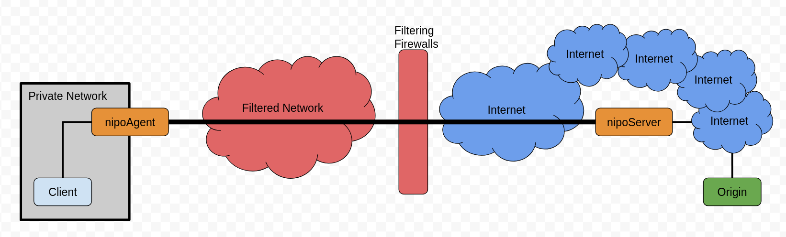
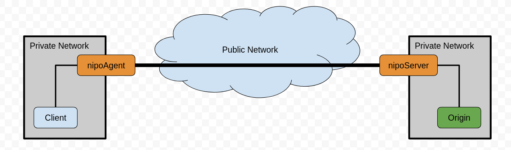
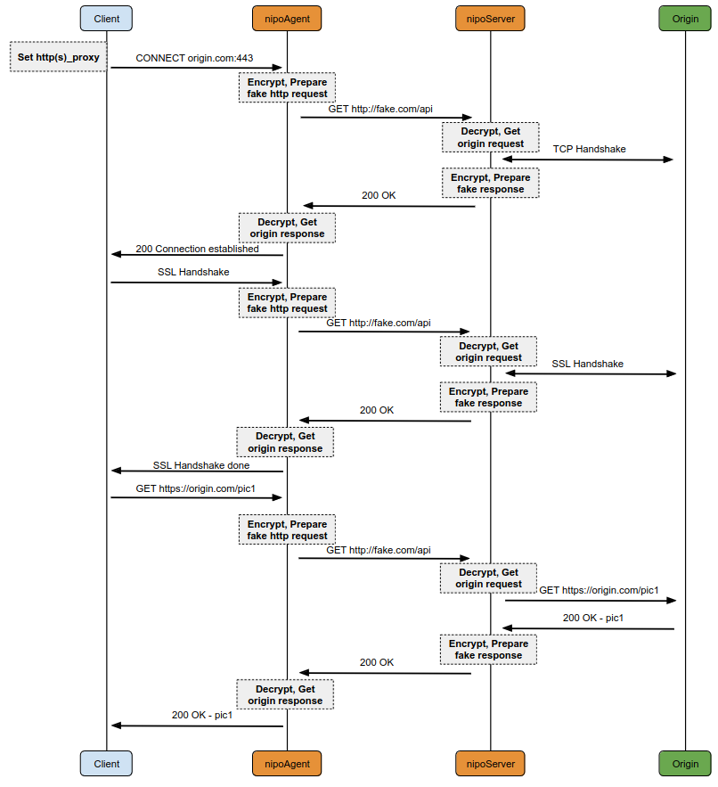

# NipoVPN

NipoVPN is a proxy that hides your traffic inside ordinary-looking HTTP requests.
It runs in two roles: an **agent** on your side and a **server** outside the
censored or monitored network. The agent wraps each request in a decoy HTTP
request (random method, endpoint and `Host`), optionally encrypts it with
AES-256-GCM and sends it over TLS. The server unwraps it, talks to the real
destination and sends the response back the same way.

It is written in C++20 on top of Boost.Asio, OpenSSL and yaml-cpp.

- [Features](#features)
- [How it works](#how-it-works)
- [Installation](#installation)
- [Quick start](#quick-start)
- [Configuration reference](#configuration-reference)
- [Security notes](#security-notes)
- [Logging](#logging)
- [Troubleshooting](#troubleshooting)
- [Contribution](#contribution)
- [License](#license)

## Features

### Client side (agent)

- **HTTP proxy and SOCKS5 proxy** for local applications (`general.protocol`).
  - HTTP: plain HTTP requests and `CONNECT` tunnels (HTTPS).
  - SOCKS5: `CONNECT` command, no authentication, with IPv4, IPv6 and domain
    name targets.
- **Multiple agents per server.** Each agent session is identified by a UUID, so
  many agents (and many clients behind each agent) can share one server.
- **Multi-threaded.** The number of worker threads is configurable for the agent
  and the server separately.

### Traffic obfuscation

- **Decoy HTTP requests.** Every request between the agent and server is a
  normal HTTP request whose method, path and `Host` header are picked at random
  from lists you configure (`methods`, `endPoints`, `fakeUrls`).
- **Configurable `User-Agent` and HTTP version** for the decoy requests.
- **Randomized TLS SNI.** With TLS enabled, the SNI sent to the server is also
  picked at random from `fakeUrls`.
- **Hidden control data.** The session ID and action travel inside the
  (encrypted) body, not in custom headers, so the outer request carries no
  NipoVPN-specific headers.

### Encryption

- **AES-256-GCM payload encryption** (on by default). The key is the SHA-256 of
  the user's token; each message gets a random 12-byte nonce and a 16-byte
  authentication tag, so tampered or wrongly keyed payloads are rejected.
- **TLS between agent and server** (`tlsEnable`): TLS 1.2 minimum, TLS 1.3
  preferred, with AEAD-only cipher suites (AES-GCM, ChaCha20-Poly1305).
- **Optional certificate verification** on the agent (`tlsVerifyPeer`) against
  a custom CA (`tlsCaFile`).

AES and TLS are independent: you can use either, both, or (not recommended)
neither.

### Connection handling

- **Two tunnel modes** for `CONNECT`/SOCKS5 traffic:
  - **Polling mode** (default, `tunnelEnable: false`): every chunk of tunneled
    data is sent as its own decoy HTTP request (`send`), and the agent polls the
    server for incoming data (`recv`). Traffic looks like many short HTTP
    requests. Polling backs off from `pullTimeout` up to 50 ms while idle and
    snaps back as soon as data arrives.
  - **Direct tunnel mode** (`tunnelEnable: true`): after the first decoy
    request, the agent–server connection becomes a raw byte pipe to the
    destination. Faster, but only the opening request is disguised and
    encrypted. Use it together with `tlsEnable`.
- **Connection reuse** (`connectionReuse`): keep one keep-alive connection
  between agent and server instead of opening a new one per request.
- **Timeouts**: an I/O timeout that closes stalled connections (`timeout`) and
  a configurable buffer size per read (`bufferSize`).

### Operations

- **Config validation at startup** with clear error messages.
- **Per-user monthly traffic limits** (e.g. 2 GB), with usage kept in an
  editable file. See [Usage limits](#usage-limits).
- **Multiple users** on one server, each with their own token. Users can be
  added, disabled or removed without a restart. See [Multiple users](#multiple-users).
- **Reload without restart** on `SIGHUP` (`systemctl reload`). See
  [Reloading the configuration](#reloading-the-configuration).
- **Warning when the public sample token is still in use.**
- **Log levels** `INFO`, `TRACE` (per-request source/destination) and `DEBUG`;
  logs go to a file and to stdout.
- **Packaging**: `.deb` packages (amd64, arm64) with systemd units, a Docker
  image and compose file, a Nix flake with a NixOS module, a Termux package,
  Windows (x86_64) builds and an [Android app](https://github.com/MortezaBashsiz/nipovpn-android).

## How it works

### Use cases

**Bypass filtering.** Run the server outside the filtered network and the agent
inside it. Filtering equipment sees only HTTP(S) requests to harmless-looking
hosts.



**Hide your requests on the Internet.** Even without censorship, NipoVPN hides
which sites you visit from anyone watching your connection.



### Request flow

```
Browser/app ──HTTP or SOCKS5──▶ Agent ──decoy HTTP(S)──▶ Server ──real request──▶ Destination
            ◀──────────────────       ◀────────────────        ◀────────────────
```

1. A local application sends a request to the agent (HTTP proxy or SOCKS5).
   SOCKS5 requests are converted to an HTTP `CONNECT` internally.
2. The agent builds an envelope `action + session ID + request bytes`, encrypts
   it with AES-256-GCM (if `aesEnable`) and Base64-encodes it.
3. The envelope is sent as the body of a decoy request such as
   `PUT /login` with `Host: cloudflare.com`, over TLS if `tlsEnable`.
4. The server decodes and decrypts the body and performs the action:
   - `request` — forward a plain HTTP request and return the response.
   - `open` — open a TCP connection to the `CONNECT` target.
   - `send` / `recv` — write to / read from that connection (polling mode).
   - `close` — close the connection.
5. The server's reply is encrypted and returned as the body of an HTTP
   `200 OK` response; the agent decrypts it and hands it to the application.



## Installation

| Platform | How |
|---|---|
| Debian / Ubuntu (amd64, arm64) | `.deb` from the [releases page](https://github.com/MortezaBashsiz/nipovpn/releases), tested on Ubuntu 24.04 |
| Build from source on Linux | [Linux build guide](guides/BuildLinux.md) |
| Docker | [Docker guide](guides/Docker.md) |
| Nix / NixOS | [Nix guide](guides/Nix.md) |
| Termux | [Termux guide](guides/InstallTermux.md) |
| Windows (x86_64) | zip from the [releases page](https://github.com/MortezaBashsiz/nipovpn/releases) (`windows-v*` tags) |
| Android | [nipovpn-android](https://github.com/MortezaBashsiz/nipovpn-android) |

### Debian package

```bash
sudo apt install ./nipovpn.deb
```

The package installs:

- `/usr/bin/nipovpn`
- `/etc/nipovpn/config.yaml` (kept on upgrade)
- `nipovpn-server.service` and `nipovpn-agent.service`

```bash
sudo systemctl enable --now nipovpn-server.service   # on the server
sudo systemctl enable --now nipovpn-agent.service    # on the agent machine
```

### From source

Requirements: a C++20 compiler, CMake ≥ 3.22, Boost ≥ 1.88, yaml-cpp ≥ 0.8 and
OpenSSL. See the [Linux build guide](guides/BuildLinux.md) for details.

```bash
cmake -DCMAKE_BUILD_TYPE=Release -B build
cmake --build build -j$(nproc)
```

## Quick start

The same binary and the same config file format are used on both sides; the
first argument selects the role:

```bash
nipovpn <server|agent> <config_file_path>
```

### 1. Prepare the log file

```bash
sudo mkdir -p /var/log/nipovpn/
sudo touch /var/log/nipovpn/nipovpn.log
```

### 2. Create a user

Generate a token of at least 32 bytes for each person. Do not use the sample
tokens from the shipped config.

```bash
openssl rand -hex 16   # prints 32 hex characters
```

On the server, list it in `server.users`. On that person's machine, put the
same token in `agent.token`:

```yaml
# server config              # agent config
server:                      agent:
  users:                       token: "<alice's token>"
    - name: alice
      token: "<alice's token>"
```

### 3. TLS certificate (if `tlsEnable: true`)

The server needs a certificate and key. A self-signed pair is enough when
`tlsVerifyPeer` is `false`:

```bash
sudo openssl req -x509 -newkey rsa:2048 -nodes -days 3650 \
  -subj "/CN=example.com" \
  -keyout /etc/nipovpn/server.key -out /etc/nipovpn/server.crt
```

### 4. Run the server

On the server, set `server.listenIp`/`server.listenPort`, then:

```bash
sudo nipovpn server /etc/nipovpn/config.yaml
```

### 5. Run the agent

On your machine, set `agent.serverIp`/`agent.serverPort` to the server's
address, set `agent.token` to one of the server's users, and make sure
`aesEnable`, `tlsEnable` and `tunnelEnable` match the server. Then:

```bash
sudo nipovpn agent /etc/nipovpn/config.yaml
```

### 6. Point your applications at the agent

```bash
# protocol: socks5
curl --socks5-hostname 127.0.0.1:8080 https://example.com

# protocol: http
curl -x http://127.0.0.1:8080 https://example.com
```

Or configure the agent's address as the SOCKS5/HTTP proxy in your browser or
operating system.

## Configuration reference

The sample config lives at [nipovpn/etc/nipovpn/config.yaml](nipovpn/etc/nipovpn/config.yaml).
Settings marked **must match** have to be the same on agent and server.

### `general`

| Key | Type | Default | Description |
|---|---|---|---|
| `aesEnable` | bool | `true` | AES-256-GCM payload encryption. **Must match.** |
| `protocol` | `http` \| `socks5` | — | Protocol the agent accepts from local applications. |
| `bufferSize` | 1–65536 | `65536` | Maximum bytes read per operation. |
| `fakeUrls` | list | — | Hosts used at random for the decoy `Host` header and TLS SNI. |
| `methods` | list | — | HTTP methods used at random for decoy requests. |
| `endPoints` | list | — | URL paths used at random for decoy requests (`/api`, `/login`, ...). |
| `timeout` | seconds | `10` | I/O timeout for stalled connections. `0` disables it. |
| `pullTimeout` | milliseconds | `1` | Base polling interval in polling mode. |
| `tunnelEnable` | bool | `false` | `true` = direct tunnel mode, `false` = polling mode. **Must match.** |
| `connectionReuse` | bool | `false` | Reuse one keep-alive connection between agent and server. |
| `tlsEnable` | bool | `false` | TLS between agent and server. **Must match.** |
| `tlsVerifyPeer` | bool | `false` | Agent verifies the server certificate. |
| `tlsCertFile` | path | — | Server certificate (PEM, chain allowed). |
| `tlsKeyFile` | path | — | Server private key (PEM). |
| `tlsCaFile` | path | — | CA file the agent uses when `tlsVerifyPeer` is on. |

### `log`

| Key | Default | Description |
|---|---|---|
| `logLevel` | `INFO` | `INFO`, `TRACE` or `DEBUG`. Errors are always logged. |
| `logFile` | — | Log file path. The directory and file must exist. |

### `server`

| Key | Default | Description |
|---|---|---|
| `threads` | `2` | Worker threads. |
| `listenIp` | `127.0.0.1` | IPv4 address to listen on. |
| `listenPort` | `8080` | Port to listen on (443 is a good choice to blend in). |

### `agent`

| Key | Default | Description |
|---|---|---|
| `threads` | `2` | Worker threads. |
| `listenIp` | `127.0.0.1` | IPv4 address for local applications to connect to. |
| `listenPort` | `8080` | Port for local applications. |
| `serverIp` | `127.0.0.1` | IPv4 address of the NipoVPN server. |
| `serverPort` | `8080` | Port of the NipoVPN server. |
| `httpVersion` | `1.1` | HTTP version in decoy requests. |
| `userAgent` | `NipoAgent` | `User-Agent` header in decoy requests. |
| `token` | — | The token this agent sends, ≥ 32 bytes when `aesEnable` is on. Must be the token of an enabled user on the server. The AES key is derived from it. |

### `server.users`

The users allowed to connect, each with their own token. Required on the server
when `aesEnable` is on. Agents do not use this block.

| Key | Default | Description |
|---|---|---|
| `name` | — | 1–64 characters of `A-Z a-z 0-9 . _ - @`. Unique. Shown in the server log. |
| `token` | — | The user's token, ≥ 32 bytes. Unique. The user's agent puts it in `agent.token`. |
| `enabled` | `true` | `false` rejects the user without deleting the entry. |
| `limit` | none | Traffic allowed per month, e.g. `2GB`, `500MB`, `1.5GiB`. See [Usage limits](#usage-limits). |

### `server.usage` (optional)

| Key | Default | Description |
|---|---|---|
| `file` | `/var/lib/nipovpn/usage.yaml` | Where per-user usage is kept. Changing it needs a restart. |
| `resetDay` | `1` | Day of the month (1–28) on which everyone's usage goes back to zero. |

## Multiple users

Every person gets their own token. The **server** lists them all in
`server.users`:

```yaml
server:
  users:
    - name: alice
      token: "4f3c9a...32 or more characters"
    - name: bob
      token: "b81e07...32 or more characters"
      enabled: false        # bob is rejected until this is set back to true
```

Each user's agent puts their token in `agent.token`. All other settings that
must match (such as `aesEnable`, `tlsEnable` and `tunnelEnable`) are shared by
everyone.

- The server identifies a request's user by which token decrypts it.
  Nothing on the wire names the user, so this adds nothing for a censor to
  fingerprint. For the same reason, users require `aesEnable: true`.
- The server log shows the user on each connection: `[SRC ...] [USER alice]`.
- A tunnel opened by one user cannot be used by another user.
- **Upgrading from `general.token`:** older configs still work. An agent reads
  `general.token` when `agent.token` is missing, and a server without a `server.users`
  list accepts `general.token` as a single user named `default`. Both log a
  deprecation warning at startup. To migrate, move the agent's token to
  `agent.token` and add it to the server's `server.users` list. Agents of any version
  keep working, since the token on the wire is the same.
- Each new connection costs one decryption attempt per enabled user until a
  token matches. A reused connection tries its last user first. This is fine
  for dozens of users; with hundreds, prefer `connectionReuse: true`.

To add, disable or remove a user, edit the config and [reload](#reloading-the-configuration).
When a user is removed or disabled, or their token changes, the server closes
their open connections and tunnels on reload.

## Usage limits

A server with a `server.users` list counts each user's traffic: the bytes they send to
websites plus the bytes they receive from them. NipoVPN's own overhead (decoy
HTTP framing, base64, encryption) is not counted. Give a user a monthly
allowance with `limit`:

```yaml
server:
  usage:
    resetDay: 1            # everyone's usage resets on the 1st of each month
  users:
    - name: alice
      token: "..."
      limit: 2GB           # KB/MB/GB/TB = powers of 1000; KiB/MiB/GiB/TiB = powers of 1024
    - name: bob
      token: "..."         # no limit
```

When a user reaches their limit, the server closes their open connections and
refuses new ones until the next period, and logs:

```
[Usage] user alice reached their limit of 2.00 GB; blocked until the next period
```

They regain access as soon as their usage drops below the limit: at the next
`resetDay`, when you raise their limit (edit the config and reload), or when you
reset them.

**Seeing and changing usage.** The server writes usage to `server.usage.file`
(default `/var/lib/nipovpn/usage.yaml`) every 30 seconds, on reload and on
shutdown:

```yaml
period: "2026-11-01"
users:
  alice: {used: 2000123456}  # 2.00 GB of 2.00 GB (100%), blocked
  bob: {used: 734003200}  # 734.00 MB, no limit
```

To reset or change a user's usage, edit their `used` number (for example set it
to `0`) and save. The server applies the edit within 30 seconds, or right away
on reload. Traffic counted in the meantime is kept on top of your value. Do not
edit `period`.

Notes:

- The file is the only record of usage, so it survives restarts. With Docker,
  keep `/var/lib/nipovpn` on a volume (the compose file does).
- If the file cannot be parsed, the server logs an error and stops saving until
  you fix it, rather than overwriting your edit.
- A user who is removed and later added back keeps their usage for the period.
- Usage is not tracked on a server without a `server.users` list.

## Reloading the configuration

Send `SIGHUP` to apply config changes without dropping other users' connections:

```bash
sudo systemctl reload nipovpn-server.service    # or nipovpn-agent.service
docker kill -s HUP nipovpn                      # Docker
kill -HUP "$(pidof nipovpn)"                    # anything else
```

The file is validated first. If it is invalid, the running configuration is
kept and the error is logged at `ERROR` level, so a typo never takes the server
down. A successful reload logs a summary, for example:

```
[Runner reload] config reloaded; 2 of 3 users enabled; access revoked for: bob
[Runner reload] closed 1 connections and 0 tunnel sessions of revoked users
```

New requests use the new settings at once. These settings only change on
restart: `listenIp`, `listenPort`, `threads`, `tlsEnable` and `server.usage.file`. If you change
them, the reload logs `... changed but needs a restart`. Certificate files are
read for every new connection, so a renewed certificate needs no reload at
all. Reload is not available on Windows.

## Security notes

- **Change the token.** The sample token is public; the program logs a warning
  if it is still in use.
- **Turn on at least one of `aesEnable` and `tlsEnable`.** Without either,
  traffic is only obfuscated, not encrypted.
- **Direct tunnel mode** sends tunneled bytes without the decoy framing or AES,
  so pair it with `tlsEnable: true`.
- **`tlsVerifyPeer: false`** protects against passive observers but not against
  an active man-in-the-middle. Enable it with a proper `tlsCaFile` if that
  matters to you. AES-GCM with a strong token still authenticates the payload.
- **Listening on `0.0.0.0` on the agent** exposes your proxy to the local
  network. Use `127.0.0.1` unless you mean to share it.

> **Protocol change:** this version uses AES-256-GCM and carries the session and
> action inside the encrypted body instead of `X-Nipo-*` headers. It is not
> compatible with older agents, servers or the Android app; upgrade all of them
> together.

## Logging

Log lines look like:

```
2026-01-01_12:00:00 [AGENT] [INFO] [<session-uuid>] [CONNECT] [SRC 127.0.0.1:51234] [ORIGIN example.com:443]
2026-01-01_12:00:00 [SERVER] [INFO] [<session-uuid>] [CONNECT] [SRC 203.0.113.7:40112] [USER alice] [ORIGIN example.com:443]
```

On the server, `[USER ...]` is the user from the `server.users` list, or `default`
when the server still uses the deprecated `general.token`.

- `INFO`: startup, effective configuration (token hidden), connections opened.
- `TRACE`: adds the destination of every forwarded request.
- `DEBUG`: adds handshake, encryption and byte-level details. Use only for
  troubleshooting.

```bash
tail -f /var/log/nipovpn/nipovpn.log
journalctl -u nipovpn-server.service -f
```

## Troubleshooting

| Symptom | Likely cause |
|---|---|
| `Configuration validation failed: ...` | A required key is missing or invalid; the message names the block. |
| `agent.token must be at least 32 bytes when aesEnable is true` | Use a longer token (`openssl rand -hex 16`). |
| `Error opening log file` | Create the log directory and file (see Quick start). |
| Server logs `Decryption Failed` / `Invalid Envelope` | `token`, `aesEnable` or NipoVPN versions differ between agent and server. With `server.users`: the agent's token is not an enabled user's token. |
| `agent.token is required` | Set the agent's token in the `agent` block (it used to be `general.token`). |
| `the server needs a server.users list with at least one user` | Add a `users` list under `server` in the server config. |
| `users belongs under the server block` | Configs from before this change had `users`/`usage` at the top level; indent them under `server:`. |
| `[WARNING] general.token is deprecated` | Move the token to `agent.token` (agent) or a `server.users` entry (server). |
| `limit must be a size with a unit` | Write the limit with a unit: `2GB`, `500MB`, `1.5GiB`, or `1024B` for bytes. |
| `[Usage] cannot read .../usage.yaml` | The usage file has a syntax error, probably from a manual edit. Fix it; usage is not saved until then. |
| `[Usage] cannot save usage` | The server cannot write `server.usage.file`; check the directory and permissions. |
| `users require general.aesEnable: true` | Users are told apart by their AES key; turn on `aesEnable`. |
| `[Runner reload] config not reloaded: ...` | The edited file is invalid; the old configuration is still running. Fix the file and reload again. |
| Agent logs `[Tunnel closed] recv refused or failed` | The server rejected the agent's token (e.g. the user was disabled) or became unreachable. |
| Agent logs `[TLS] [ERROR]` | `tlsEnable` differs between the two sides, or the certificate/key path is wrong. |
| `[CONNECT] [ERROR] [To Server]` | Agent cannot reach `serverIp:serverPort` (firewall, wrong address, server not running). |

## Contribution

See the [contribution guide](CONTRIBUTING.md). In short: branch from `dev`,
format with `scripts/format.sh`, build and test, and open a pull request against
`dev`.

## License

NipoVPN is released under the [GNU General Public License v3.0](LICENSE).

